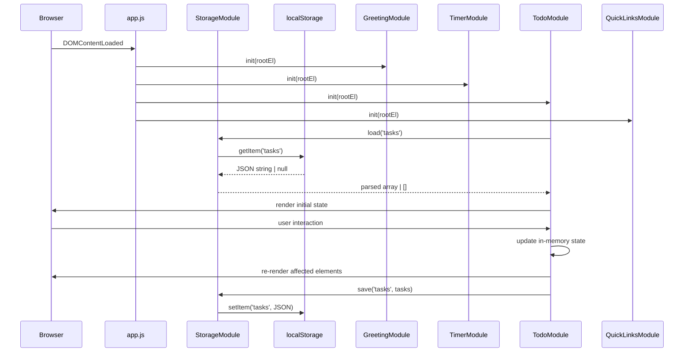

# Design Document

## Todo Life Dashboard

---

## Overview

The Todo Life Dashboard is a **single-page, client-side web application** built with plain HTML, CSS, and Vanilla JavaScript — no frameworks, no build tools, no server. The entire application is delivered as a set of static files that can be opened directly in any modern browser via `file://` or any static HTTP host.

The application consolidates four productivity widgets on one page:

1. **Greeting Widget** — live clock, date, and time-of-day greeting
2. **Focus Timer Widget** — 25-minute Pomodoro countdown with Start / Stop / Reset
3. **To-Do List Widget** — add, edit, complete, and delete tasks
4. **Quick Links Widget** — add, launch, and delete favourite-site shortcuts

All user data lives exclusively in `window.localStorage`. No network request is ever made for data operations.

---

## Architecture

### File Structure

The project uses a minimal, flat structure with exactly one CSS file and one JavaScript file. No build step is required.

```
todo-life-dashboard/
├── index.html       # Page skeleton, links CSS & JS
├── css/
│   └── style.css    # All styles, including responsive breakpoints
└── js/
    └── app.js       # All JavaScript logic (storage, greeting, timer, todo, quicklinks)
```

`index.html` loads the stylesheet in `<head>` and the script at the bottom of `<body>`:

```html
<link rel="stylesheet" href="css/style.css">
<script src="js/app.js"></script>
```

No ES module syntax (`import`/`export`) is used. `app.js` is a plain script that runs in the global browser context.

### Internal Organisation of `app.js`

All logic is divided into clearly-commented sections inside `app.js`. Each section is implemented as a **`const` object literal** (a lightweight namespace) so the code remains readable and the functions are easy to reference without polluting the global scope beyond the module objects themselves.

```
app.js
├── // ─── STORAGE MODULE ──────────────────────────────────────────
│   const StorageModule = { load, save, isAvailable }
│
├── // ─── GREETING MODULE ─────────────────────────────────────────
│   const GreetingModule = { init, getGreetingForHour, formatTime, formatDate }
│
├── // ─── TIMER MODULE ────────────────────────────────────────────
│   const TimerModule = { init, formatMMSS }
│
├── // ─── TODO MODULE ─────────────────────────────────────────────
│   const TodoModule = { init, validateTaskDescription }
│
├── // ─── QUICKLINKS MODULE ───────────────────────────────────────
│   const QuickLinksModule = { init, validateLink }
│
└── // ─── BOOTSTRAP ───────────────────────────────────────────────
    document.addEventListener('DOMContentLoaded', () => {
      GreetingModule.init(...)
      TimerModule.init(...)
      TodoModule.init(...)
      QuickLinksModule.init(...)
    })
```

Each module object owns its own closure state (task array, interval handle, etc.) and exposes only the functions needed by the bootstrap block or by other modules. There are no cross-module imports — `StorageModule` is simply referenced by name where needed since everything is in the same file.

### Runtime Model



Everything originates from a single `<script src="js/app.js">` tag. There are no module boundaries at the file level; the object-literal pattern provides logical separation within the file.

---

## Components and Interfaces

All components below are **sections within `app.js`**, implemented as `const` object literals. There is no `import`/`export` syntax. Pure functions (e.g. `getGreetingForHour`, `validateTaskDescription`) are kept as named properties on their respective module objects so they can be tested via a global test namespace (see Testing Strategy).

### 1. `StorageModule` — LocalStorage Helpers

**Responsibility**: Wrap `window.localStorage` with error handling and JSON serialisation.

```js
const StorageModule = {
  load(key),       // → any[]
  save(key, data), // → { ok: boolean, error?: string }
  isAvailable(),   // → boolean
}
```

**`load(key)`** — reads `localStorage[key]`, parses JSON. Returns `[]` if the key is absent, data is corrupt, or `localStorage` is unavailable. Logs a `console.warn` on corruption.

**`save(key, data)`** — JSON-serialises `data` and writes it to `localStorage[key]`. Returns `{ ok: false, error: 'quota' }` on `QuotaExceededError`, `{ ok: false, error: 'unavailable' }` if `localStorage` is inaccessible, and `{ ok: true }` on success.

**`isAvailable()`** — probes `localStorage` with a small test write/delete. Returns `false` if `localStorage` throws (private browsing, unsupported browser).

---

### 2. `GreetingModule` — Greeting Widget

**Responsibility**: Update the DOM every second with the current time, date, and greeting string.

```js
const GreetingModule = {
  init(rootEl),
  getGreetingForHour(hour), // → string  (pure, exposed for testing)
  formatTime(date),         // → string  (pure, exposed for testing)
  formatDate(date),         // → string  (pure, exposed for testing)
}
```

**Internal logic**:
- `init()` calls `_update()` immediately, then via `setInterval(_update, 1000)`.
- `_update()` calls `getGreetingForHour(hour)`, `formatTime(date)`, and `formatDate(date)` and writes results to the DOM.
- If `new Date()` returns an invalid date, falls back to placeholder text.

**Key pure functions**:

```js
getGreetingForHour(hour)  // hour: 0–23
// returns: "Good Morning" | "Good Afternoon" | "Good Evening" | "Good Night"

formatTime(date)
// returns: "HH:MM:SS" (24-hour), e.g. "09:05:34"

formatDate(date)
// returns: "Wednesday, 15 October 2026"
```

---

### 3. `TimerModule` — Focus Timer Widget

**Responsibility**: Manage a 25-minute countdown with Start, Stop, Reset controls.

```js
const TimerModule = {
  init(rootEl),
  formatMMSS(totalSeconds), // → string  (pure, exposed for testing)
}
```

**Internal state** (closure variables):

```js
let remainingSeconds = 1500   // 25 * 60
let intervalId = null         // null when stopped
let isRunning = false
```

**Internal functions**:

```js
_start()      // starts countdown if not running; resets to 1500 first if at 0
_stop()       // pauses countdown, retains remaining time
_reset()      // clears interval, sets remainingSeconds = 1500, updates DOM
_tick()       // called every second; decrements; fires _onComplete() at 0
_onComplete() // clears interval, shows notification for ≥5 s
```

---

### 4. `TodoModule` — To-Do List Widget

**Responsibility**: Full CRUD for tasks with LocalStorage persistence.

```js
const TodoModule = {
  init(rootEl),
  validateTaskDescription(raw), // → { ok, trimmed?, error? }  (pure, exposed for testing)
}
```

**Internal state** (closure variables):

```js
let tasks = []        // Task[]  — single source of truth
let editingId = null  // string | null — id of task currently in edit mode
```

**Internal functions**:

```js
_addTask(description)           // → Result
_editTask(id, newDescription)   // → Result
_deleteTask(id)
_toggleComplete(id)
_renderList()                   // full re-render of task list DOM
_persist()                      // calls StorageModule.save('tasks', tasks)
```

`Result` is a plain object `{ ok: boolean, error?: string }` used to surface validation failures to the UI without throwing.

**Validation** (pure, property of `TodoModule`):

```js
TodoModule.validateTaskDescription(raw)
// Rejects empty / whitespace-only strings
// Trims leading/trailing whitespace on success
// Returns error if trimmed length > 200 (add) or > 512 (edit)
```

---

### 5. `QuickLinksModule` — Quick Links Widget

**Responsibility**: CRUD for quick links with LocalStorage persistence.

```js
const QuickLinksModule = {
  init(rootEl),
  validateLink(label, url), // → { ok, errors[] }  (pure, exposed for testing)
}
```

**Internal state** (closure variable):

```js
let links = []   // Link[]
```

**Internal functions**:

```js
_addLink(label, url)  // → Result
_deleteLink(id)
_launchLink(url)      // window.open(url, '_blank')
_renderLinks()
_persist()            // calls StorageModule.save('quicklinks', links)
```

**Validation** (pure, property of `QuickLinksModule`):

```js
QuickLinksModule.validateLink(label, url)
// label: 1–50 chars (after trim)
// url: 1–2048 chars, must start with "http://" or "https://"
```

---

## Data Models

### Task Object

```js
{
  id:        string,   // crypto.randomUUID() or Date.now().toString() fallback
  text:      string,   // 1–200 characters (trimmed)
  completed: boolean,  // false on creation
  createdAt: number    // Date.now() timestamp, for ordering
}
```

### Link Object

```js
{
  id:    string,   // crypto.randomUUID() or Date.now().toString() fallback
  label: string,   // 1–50 characters (trimmed)
  url:   string    // 1–2048 characters, starts with http:// or https://
}
```

### LocalStorage Schema

| Key | Value type | Description |
|-----|-----------|-------------|
| `"tasks"` | `JSON string` → `Task[]` | Ordered array of all tasks |
| `"quicklinks"` | `JSON string` → `Link[]` | Ordered array of all quick links |

No other keys are written. The timer and greeting have no persistent state.

### Serialisation Invariant

Both arrays are written as a **complete replacement** on every mutation (not patched). This keeps the serialisation logic simple and avoids partial-write bugs.

---

## UI Layout

### Responsive Grid

```
≤ 600px   (mobile)      →  1-column stack
601–1024px (tablet)     →  2-column grid
≥ 1025px  (desktop)     →  4-column grid
```

Implemented with CSS Grid in `css/style.css`:

```css
.dashboard-grid {
  display: grid;
  grid-template-columns: repeat(auto-fit, minmax(280px, 1fr));
  gap: 1.5rem;
}
```

The `auto-fit` + `minmax` approach naturally produces 1, 2, or 4 columns at the specified breakpoints without explicit media queries for the column count, though explicit breakpoints can be added for pixel-perfect control.

### Widget Layout (wireframe)

```
┌──────────────────────────────────────────────────────────────┐
│  GREETING           │  FOCUS TIMER      │  TO-DO LIST  │ LINKS │
│  09:05:34           │  24:47            │  [ Add task ] │ [+]  │
│  Wednesday, 15 Oct  │  [Start][Stop][R] │  ☐ Task A    │ [G↗] │
│  Good Morning       │  ________________ │  ☑ Task B    │ [G↗] │
│                     │  (notif area)     │  ...          │ ...  │
└──────────────────────────────────────────────────────────────┘
```

Each widget is a `<section>` with a `<h2>` heading and its own content area.

### Accessibility

- All interactive elements (buttons, checkboxes, input fields) have a minimum touch target of **44×44 CSS pixels** via `min-height`/`min-width` or padding.
- All buttons have descriptive `aria-label` attributes where the visible text is ambiguous (e.g., a delete "✕" button).
- Form inputs have associated `<label>` elements.
- Live clock region uses `aria-live="off"` (it would be too noisy with `assertive`/`polite`).
- Timer completion notification uses `role="alert"` so screen readers announce it.
- Minimum font size: **14px** enforced in `css/style.css` via `font-size: 14px` on `body` and `min()` guards.
- Colour contrast: design uses a dark-on-light palette targeting ≥4.5:1 for normal text, ≥3:1 for large text.

---

## State Management

Each module object is an isolated state machine backed by closure variables. The overall approach is:

1. **Load** — on `init()`, read from LocalStorage into the in-memory array.
2. **Mutate** — all user actions update the in-memory array first.
3. **Render** — after every mutation, re-render the widget's DOM from the in-memory array (full re-render; no virtual DOM diffing needed at this scale).
4. **Persist** — after successful render, write the in-memory array to LocalStorage via `StorageModule.save()`. If the write fails, show an error message but keep the in-memory state intact for the current session.

This "in-memory first, persist second" pattern means the UI is never blocked by storage I/O, and storage failures degrade gracefully.

**Edit-mode concurrency** (Requirement 5.6): `TodoModule` tracks `editingId`. When `_activateEdit(id)` is called and `editingId !== null && editingId !== id`, it first calls `_cancelEdit(editingId)` before opening the new edit.

---

## Error Handling

| Failure scenario | Behaviour |
|-----------------|-----------|
| `localStorage` unavailable on load | Show persistent warning banner; operate with empty in-memory state |
| `localStorage` read contains corrupt JSON | `StorageModule.load()` returns `[]`, logs `console.warn`; widget shows empty state + warning |
| `localStorage` write fails (generic) | Show inline error message near the affected widget; retain in-memory state |
| `localStorage` write fails (quota exceeded) | Show specific error: "Storage limit reached — data was not saved" |
| `Date` object returns invalid | Greeting shows "Time unavailable"; timer is not affected (it uses `setInterval` only) |
| URL malformed at Quick Link launch time | Show inline error; do not call `window.open` |
| Adding task at 100-task limit | Show inline validation message; reject submission |

All user-facing messages are rendered inside dedicated `<div role="alert">` elements within each widget, so screen readers announce them automatically.

---

## Key Algorithms

### Greeting Logic

```js
getGreetingForHour(hour) {
  // hour: integer 0–23
  if (hour >= 5  && hour <= 11) return "Good Morning";
  if (hour >= 12 && hour <= 17) return "Good Afternoon";
  if (hour >= 18 && hour <= 21) return "Good Evening";
  return "Good Night";  // 22–23 and 0–4
}
```

The greeting is re-evaluated every second (as part of the same `setInterval` that updates the clock), so it transitions within 1 second of the hour boundary — well within the 60-second tolerance specified in Requirement 2.6.

### Timer Countdown

```js
_tick() {
  if (remainingSeconds <= 0) { _onComplete(); return; }
  remainingSeconds--;
  _renderDisplay(remainingSeconds);
}

_start() {
  if (isRunning) return;                    // Req 3.8: ignore duplicate start
  if (remainingSeconds === 0) _reset();     // Req 3.7: reset before starting at 0
  isRunning = true;
  intervalId = setInterval(_tick, 1000);
}
```

`setInterval` drift is acceptable for a Pomodoro timer (cumulative drift over 25 min is typically <1 s). If sub-second precision were required, a `Date`-anchored approach would be used instead.

### Serialisation Round-Trip

```js
// save
localStorage.setItem(key, JSON.stringify(array));

// load
const raw = localStorage.getItem(key);
if (raw === null) return [];
try {
  const parsed = JSON.parse(raw);
  return Array.isArray(parsed) ? parsed : [];
} catch {
  console.warn(`[storage] corrupt data at key "${key}"`);
  return [];
}
```

This ensures `load(save(x)) ≡ x` for any valid `Task[]` or `Link[]`.

### Input Validation

```js
validateTaskDescription(raw) {
  const trimmed = raw.trim();
  if (trimmed.length === 0) return { ok: false, error: "Task description cannot be empty." };
  if (trimmed.length > 200) return { ok: false, error: "Task description cannot exceed 200 characters." };
  return { ok: true, trimmed };
}

validateLink(label, url) {
  const errors = [];
  const tLabel = label.trim();
  const tUrl   = url.trim();
  if (tLabel.length === 0)  errors.push("Label is required.");
  if (tLabel.length > 50)   errors.push("Label cannot exceed 50 characters.");
  if (tUrl.length === 0)    errors.push("URL is required.");
  else if (tUrl.length > 2048) errors.push("URL cannot exceed 2048 characters.");
  else if (!/^https?:\/\//i.test(tUrl)) errors.push("URL must start with http:// or https://.");
  return { ok: errors.length === 0, errors };
}
```

---

## Correctness Properties

*A property is a characteristic or behavior that should hold true across all valid executions of a system — essentially, a formal statement about what the system should do. Properties serve as the bridge between human-readable specifications and machine-verifiable correctness guarantees.*

### Property 1: Greeting covers all hours

*For any* integer hour in [0, 23], `GreetingModule.getGreetingForHour(hour)` returns exactly one of "Good Morning", "Good Afternoon", "Good Evening", or "Good Night", and never returns an empty string or throws.

**Validates: Requirements 2.1, 2.2, 2.3, 2.4, 2.5**

---

### Property 2: Greeting is stable within a time slot

*For any* two hours `h1` and `h2` that fall within the same named time slot (both in [5,11], both in [12,17], both in [18,21], or both in [0,4] ∪ [22,23]), `GreetingModule.getGreetingForHour(h1) === GreetingModule.getGreetingForHour(h2)`.

**Validates: Requirements 2.1, 2.2, 2.3, 2.4, 2.5**

---

### Property 3: Whitespace-only task descriptions are always rejected

*For any* string composed entirely of whitespace characters (space, tab, newline, etc.), `TodoModule.validateTaskDescription(raw).ok === false`.

**Validates: Requirements 4.3, 5.4**

---

### Property 4: Valid task descriptions are accepted and trimmed

*For any* string whose trimmed form has length in [1, 200], `TodoModule.validateTaskDescription` returns `{ ok: true, trimmed }` where `trimmed` equals `raw.trim()`.

**Validates: Requirements 4.2, 5.3**

---

### Property 5: Task serialisation round-trip

*For any* valid `Task[]` array, serialising it to JSON and deserialising it produces an array equal (by structural value) to the original — every task's `id`, `text`, `completed`, and `createdAt` fields are preserved.

**Validates: Requirements 8.3**

---

### Property 6: Quick Link serialisation round-trip

*For any* valid `Link[]` array, serialising it to JSON and deserialising it produces an array where every link's `id`, `label`, and `url` fields are preserved.

**Validates: Requirements 12.3**

---

### Property 7: Valid links pass validation

*For any* label with trimmed length in [1, 50] and URL that starts with `"http://"` or `"https://"` and has trimmed length in [1, 2048], `QuickLinksModule.validateLink(label, url).ok === true` and `.errors` is empty.

**Validates: Requirements 9.2, 9.5**

---

### Property 8: Invalid URLs are always rejected

*For any* URL string whose trimmed form does not start with `"http://"` or `"https://"` (case-insensitive), `QuickLinksModule.validateLink(anyLabel, url).ok === false` and `.errors` contains at least one entry.

**Validates: Requirements 9.5**

---

### Property 9: `formatMMSS` is consistent with total seconds

*For any* integer `s` in [0, 1500], `TimerModule.formatMMSS(s)` returns a string matching the pattern `MM:SS` where `MM = Math.floor(s/60)` zero-padded to 2 digits and `SS = s % 60` zero-padded to 2 digits.

**Validates: Requirements 3.1, 3.3**

---

## Testing Strategy

### Dual Testing Approach

The project uses two complementary layers:

1. **Unit / property tests** — verify pure functions in isolation (no DOM, no LocalStorage).
2. **Integration tests** — verify widget initialisation, user interactions, and DOM mutations (via a headless browser or jsdom).

### Exposing Pure Functions for Testing

Since `app.js` is a plain script with no ES module exports, pure functions are exposed on a global test namespace that is attached only during test runs:

```js
// At the bottom of app.js, behind a test-environment guard:
if (typeof window !== 'undefined' && window.__TEST_MODE__) {
  window.__test = {
    getGreetingForHour: GreetingModule.getGreetingForHour,
    formatTime:         GreetingModule.formatTime,
    formatDate:         GreetingModule.formatDate,
    formatMMSS:         TimerModule.formatMMSS,
    validateTaskDescription: TodoModule.validateTaskDescription,
    validateLink:       QuickLinksModule.validateLink,
    storageLoad:        StorageModule.load,
    storageSave:        StorageModule.save,
    storageIsAvailable: StorageModule.isAvailable,
  };
}
```

In a Node.js / jsdom test environment (e.g., Vitest with jsdom), set `global.window.__TEST_MODE__ = true` before loading `app.js`, then access functions via `window.__test.*`.

### Property-Based Testing

The feature is well-suited for property-based testing in the pure-logic layer. The recommended library is **[fast-check](https://github.com/dubzzz/fast-check)** (works in any JS environment without a framework, runs in Node.js via `vitest` or `jest`).

Each property test runs a **minimum of 100 iterations**.

Tag format for each test: `// Feature: todo-life-dashboard, Property <N>: <property title>`

| Property | fast-check arbitraries to use |
|----------|-------------------------------|
| 1 (Greeting covers all hours) | `fc.integer({ min: 0, max: 23 })` |
| 2 (Greeting stable within slot) | `fc.integer({ min: 0, max: 23 })` paired by slot |
| 3 (Whitespace rejection) | `fc.stringOf(fc.constantFrom(' ', '\t', '\n', '\r'))` |
| 4 (Valid description trimming) | `fc.string()` filtered to trimmed length in [1,200] |
| 5 (Task round-trip) | `fc.array(fc.record({ id: fc.uuid(), text: fc.string(), completed: fc.boolean(), createdAt: fc.integer() }))` |
| 6 (Link round-trip) | `fc.array(fc.record({ id: fc.uuid(), label: fc.string(), url: fc.string() }))` |
| 7 (Valid link acceptance) | `fc.string()` for label + URL prefixed with `http://` or `https://` |
| 8 (Invalid URL rejection) | `fc.string()` filtered so trimmed form does not start with `http://` or `https://` |
| 9 (formatMMSS) | `fc.integer({ min: 0, max: 1500 })` |

All property tests access the functions under test via `window.__test.*` (see above).

### Unit Tests (example-based)

Focus on specific examples and edge cases not easily expressed as universal properties:

- Timer: start at 00:00 → resets to 25:00 then starts (Req 3.7)
- Timer: duplicate start is a no-op (Req 3.8)
- Timer: completion notification appears at 00:00 and persists ≥5 s (Req 3.6)
- Todo: adding the 101st task is rejected (Req 4.5)
- Todo: edit-mode auto-cancel when a second task is edited (Req 5.6)
- Todo: toggle complete → strikethrough applied; re-toggle → strikethrough removed (Req 6.2, 6.3)
- Storage: `load()` returns `[]` when `localStorage` contains corrupt JSON (Req 8.1, 12.5)
- Storage: `save()` returns `{ ok: false, error: 'quota' }` on `QuotaExceededError` (Req 14.3)
- QuickLinks: activating a link opens a new tab with the correct URL (Req 10.1)
- QuickLinks: activating a link with a malformed URL shows an error, no new tab opened (Req 10.2)
- Greeting: invalid `Date` object produces fallback text (Req 1.4, 2.7)

### Integration Tests

Run against the full page in a headless browser (e.g., Playwright or Puppeteer):

- All four widgets render on `DOMContentLoaded`.
- Tasks and links survive a simulated page reload (via `localStorage` mock).
- Responsive layout: viewport resize produces correct column count.
- Screen reader: `role="alert"` region is announced after storage failure.
- `localStorage` unavailable: warning banner is visible and widgets operate in-memory.

### Not Tested by PBT

- Responsive CSS layout (snapshot or visual regression)
- Touch target sizes (accessibility audit tool, e.g., Lighthouse)
- Cross-browser rendering (manual + CI matrix)
- Contrast ratios (automated accessibility scanner)
